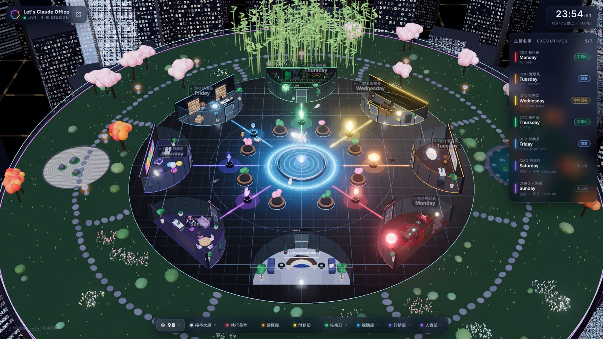
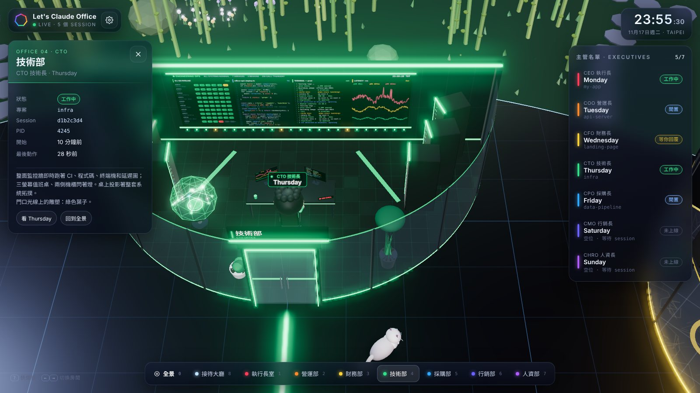
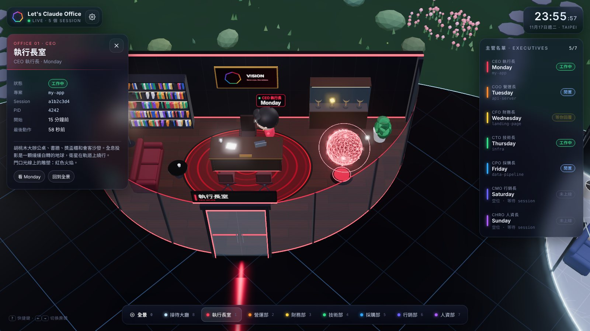
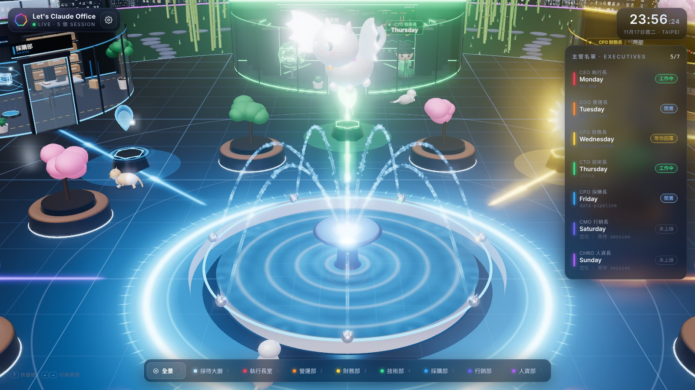
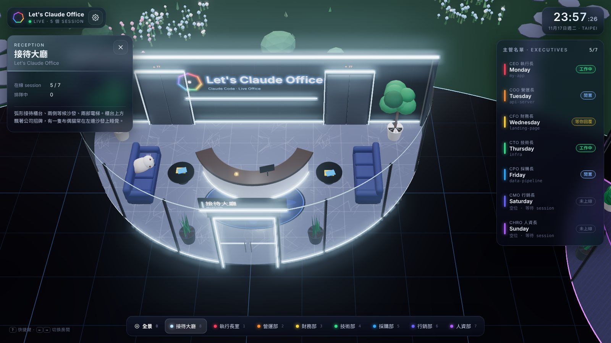
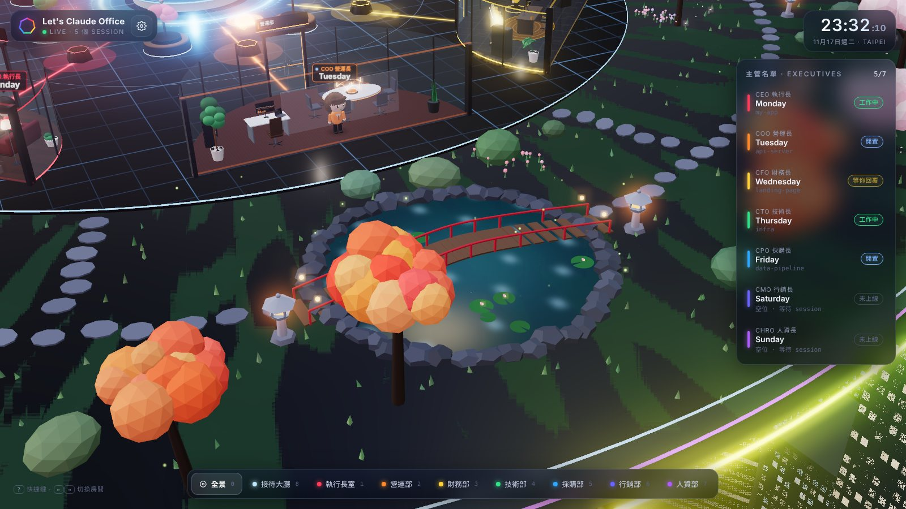
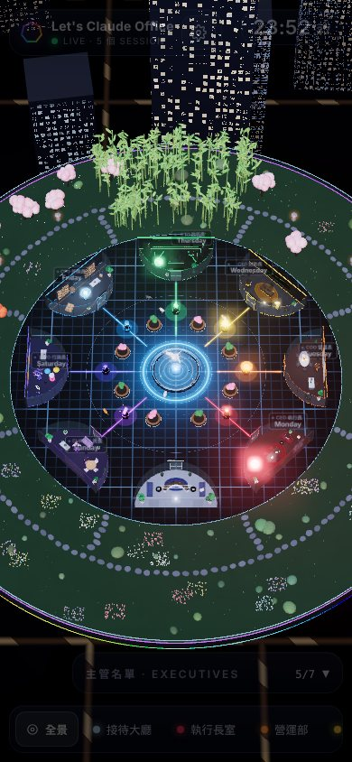

# Let's Claude Office

把你正在跑的 Claude Code session，變成一座霓虹 3D 辦公室裡的七位 Q 版主管。



- **工作中**：主管快步走回自己的辦公室，坐下來敲鍵盤。
- **等你回覆**（要按允許、要回答問題）：主管停在原地，轉頭向你揮手，名牌閃黃字。
- **閒置**：主管在走廊和庭園裡到處逛。
- 第 N 個開的 session，坐第 N 位主管：Monday（CEO）、Tuesday（COO）……一直到 Sunday（CHRO）。

| 技術部 | 執行長室 | 噴水池 |
| --- | --- | --- |
|  |  |  |
| **接待大廳** | **庭園** | **手機** |
|  |  |  |

## 安裝

在 Claude Code 裡輸入：

```text
/plugin marketplace add allenlee31353/lets-claude-office
/plugin install lets-claude-office@lets-claude-office
```

裝好之後**開一個新的 Claude Code session**（hooks 只會在新 session 生效），再輸入：

```text
/office
```

瀏覽器就會打開 `~/.claude/lets-office/index.html`。

> 頁面第一次開啟時，需要網路從 cdn.jsdelivr.net 下載 Three.js，之後瀏覽器會快取。

## 它記錄了什麼

`scripts/office-hook.sh` 會掛在 SessionStart、UserPromptSubmit、PreToolUse、PostToolUse、Notification、Stop、SessionEnd 這幾個事件上，**只記錄**：

| 欄位 | 範例 |
| --- | --- |
| session id | `a1b2c3d4-…` |
| 專案資料夾名稱（不是完整路徑） | `my-app` |
| 狀態 | `working` / `waiting` / `idle` |
| process id | `4242` |
| 開始時間、最後更新時間 | Unix 秒數 |

Prompt 內容、工具的輸入輸出、通知訊息全文**都不會寫進任何檔案**。這支腳本不輸出任何東西、永遠回傳 0，所以不會擋到 Claude。

狀態規則：

| 事件 | 狀態 |
| --- | --- |
| SessionStart | 閒置（auto-compact 時維持原狀） |
| UserPromptSubmit、PostToolUse、其他工具的 PreToolUse | 工作中 |
| PreToolUse：`AskUserQuestion`、`ExitPlanMode` | 等你回覆 |
| Notification：`permission_prompt`、`elicitation_dialog` | 等你回覆 |
| Notification：`idle_prompt`（閒置提醒） | 不變 |
| Stop | 閒置 |
| SessionEnd | 離開座位 |

七個座位都坐滿時，後來的 session 會排隊，等有人離開就依開啟順序補位。行程已經結束的 session 會被自動清掉。

## 操作

| 按鍵 | 動作 |
| --- | --- |
| `←` `→` | 上一間 / 下一間房間 |
| `1`–`7` | 飛到 CEO … CHRO 的辦公室 |
| `8` | 接待大廳 |
| `0` | 回到全景 |
| `Shift` + `1`–`7` | 跟著那位主管走 |
| `S` | 設定 |
| `Esc` | 關閉資訊卡或對話框 |

點房間、主管、貓、雕塑或吉祥物，鏡頭會飛過去，旁邊跳出資訊卡。設定面板可以改公司名稱、房間名稱、主管名字和職稱，只存在你的瀏覽器（localStorage）裡。

如果系統開了「減少動態效果」，開場會直接跳過，鏡頭會直接切換而不是用飛的，場景裡的動態也會放慢。

## 沒有 session 的時候

如果頁面讀不到 `roster.js`（例如直接從 GitHub Pages 打開），會自動進入**示範模式**，讓主管們自己動起來。你也可以在設定裡打開示範模式。網址加上 `?demo` 也有一樣的效果。

## 開發

```text
src/            場景、HUD 和 session 的原始碼（依檔名順序串接）
web/index.html  建置後的單一 HTML 檔（plugin 用的就是這個）
scripts/        office-hook.sh（hooks）、open.sh（/office 用）
hooks/          hooks.json
commands/       /office 指令
tests/          hook 測試
tools/          build.mjs、shoot.mjs（無頭瀏覽器截圖）
```

```bash
node tools/build.mjs          # 從 src/ 產生 web/index.html
bash tests/test-hook.sh       # 模擬各種 hook 事件
NO_JQ=1 bash tests/test-hook.sh   # 測沒有 jq 的環境
```

hook 腳本支援 macOS 內建的 bash 3.2、Linux 和 Windows 的 Git Bash。有 `jq` 就用 `jq`，沒有就用內建的 awk 解析器。

## English

**Let's Claude Office** turns your running Claude Code sessions into seven chibi executives in a neon Three.js office. Working sessions hurry back to their desks, sessions waiting for you stop and wave with a blinking yellow name tag, and idle ones wander the corridor and garden. The hooks store only session id, project folder name, state, pid and timestamps, never prompt text. Install with `/plugin marketplace add allenlee31353/lets-claude-office`, then `/plugin install lets-claude-office@lets-claude-office`, start a new session and run `/office`.

## 授權

MIT
